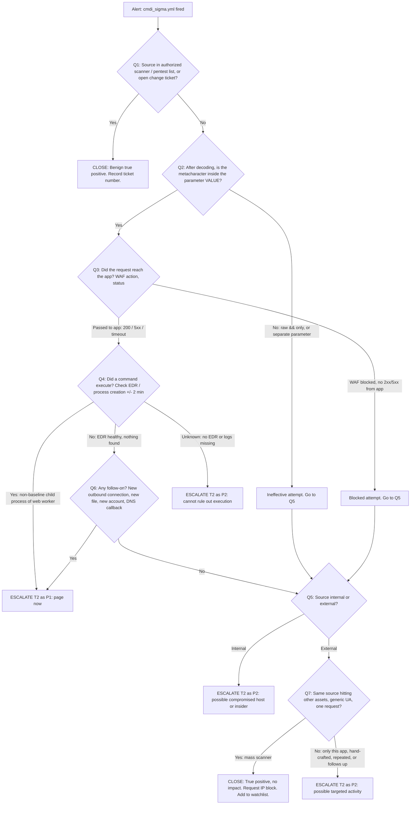

# IR Playbook: OS Command Injection Alert (Tier 1)

| | |
|---|---|
| **Playbook ID** | PB-CMDI-001 |
| **Version / date** | 1.0 / 2026-11-22 |
| **Owner** | [SOC lead / team] |
| **Trigger** | Sigma rule *OS Command Injection Attempt Against Ping Endpoint (Web Server Logs)*, id `2bd67884-7866-4e1d-8b23-b383fa80e288`, level **high** |
| **Audience** | Tier 1 SOC analyst |
| **Related** | `CTI_CONTEXT.md` (context and ATT&CK mapping), `detection_rules/cmdi_sigma.yml` |
| **MITRE ATT&CK** | T1190 (Initial Access), T1059 (Execution) |

> **Assumptions to confirm before go-live.** The playbook assumes a `/ping` endpoint that takes its target in the query string and (to be confirmed with the developer) passes it to a shell. Timings below are example targets: align them with your SLAs. Log field names, index names and EDR products vary; the queries in section 3 are templates.

## 0. What this alert does and does not tell you

- **It means** a request to the ping endpoint contained shell metacharacters (`;`, `|`, `&&`, `$(`, backtick, newline), raw or encoded. A legitimate request contains only a hostname or IP address.
- **It does not mean** the command ran. The web log records the *request*. Whether anything executed is established only by process-creation telemetry on the host (section 3, Q4).
- **It does not see** payloads in POST bodies, cookies or headers. A quiet rule is not proof of a quiet endpoint.

**Ground rules**

1. Do **not** open, replay or "test" the URL from the alert. Do not browse to any domain in it.
2. Do **not** contact the source IP.
3. Defang indicators in tickets and chat (`203[.]0[.]113[.]5`, `hxxp://`).
4. Work in UTC. Note the time zone of every source you query.
5. Preserve before you change anything: export the raw log lines first.
6. Tier 1 does not isolate, reboot, kill processes or wipe hosts. That decision belongs to Tier 2 / the incident lead (section 5).

## 1. Intake (target: acknowledge within 15 minutes)

Record in the ticket, copying from the **raw** log line (not the alert summary):

| Field | Source |
|---|---|
| Alert time, rule id, host / site | Alert |
| Source IP (`c-ip`) and any `X-Forwarded-For` | Web log / WAF |
| Method, path (`cs-uri-stem`), query (`cs-uri-query`) | Web log |
| HTTP status, response size, time taken | Web log |
| User agent | Web log |
| Asset owner, criticality, internet-facing? | CMDB |

**Decode the payload.** The query string may be URL-encoded or double-encoded; judge the *decoded* value.

```bash
# decode once, then again if percent signs remain (use a trusted offline tool, never a website)
python3 -c "import urllib.parse,sys; s=sys.argv[1]; print(urllib.parse.unquote(urllib.parse.unquote(s)))" 'ip=8.8.8.8%253Bid'
```
Write down the operator used (`;`, `|`, `&&`, `$()`, backtick, newline) and the command it was trying to run (see appendix A).

## 2. Triage decision tree (target: decision within 30 minutes)



**Same logic in table form**

| # | Question | How to answer | If yes | If no |
|---|---|---|---|---|
| Q1 | Authorized test? | Scanner / pentest list, change calendar, ask the owner | Close as benign TP | Continue |
| Q2 | Is the metacharacter *effective*? | Decode. `;` `\|` `$()` backtick `%26` newline inside the value are effective. A **raw `&&`** splits into a separate parameter, so it does not inject but still shows intent. | Continue | Treat as ineffective attempt, go to Q5 |
| Q3 | Did it reach the app? | WAF action; web status; response time | Go to Q4 | Blocked attempt, go to Q5 |
| Q4 | **Did the command execute?** | Process creation under the web worker (section 3) | **Escalate P1** | If no telemetry exists: **escalate P2**. If healthy telemetry and nothing found: Q6 |
| Q5 | Internal or external source? | Match `c-ip` (and `X-Forwarded-For`) to RFC 1918 / corporate ranges and the asset inventory | **Internal: escalate P2** (compromised host or insider) | External: Q7 |
| Q6 | Follow-on activity? | Outbound connections, new files, new accounts, DNS callbacks after the request | **Escalate P1** | Go to Q5 |
| Q7 | Indiscriminate scanner? | Same IP across many assets, generic user agent, single request, no follow-up | Close as TP, no impact; request block | **Escalate P2** (targeted) |

**Priorities (example targets)**

| Priority | Meaning | T1 action | T2 response target |
|---|---|---|---|
| **P1** | Execution confirmed or follow-on activity seen | Page T2 now; do not wait for the queue | 15 min |
| **P2** | Execution not ruled out, internal source, or targeted pattern | Hand off through the queue with the SBAR note (section 6) | 1 hour |
| **P3** | Authorized test, blocked or ineffective external scan | Close with documentation | n/a |

## 3. Log sources and exact checks

Search a window of **5 minutes before to 15 minutes after** the request time, on the **same host**, then widen if you find something.

| # | Source | Look for | Notes |
|---|---|---|---|
| 1 | **WAF** (e.g. ModSecurity, AWS WAF, Cloudflare, appliance) | Rule match and **action** (block / allow / count) for this source IP and URI; other requests from the same IP | A request allowed by the WAF but matching the Sigma rule means the WAF did not stop it: weigh toward escalation |
| 2 | **Web server access log** | IIS W3C: `c-ip`, `cs-uri-stem`, `cs-uri-query`, `sc-status`, `time-taken`. Nginx: `$remote_addr`, `$request`, `$status`, `$body_bytes_sent`, `$request_time`. Apache: `%h %r %>s %B %D` | **Response size** far from the endpoint's usual size can mean command output was returned. **Long response time** (for example the normal 1 to 4 seconds becoming 5, 10, 30) suggests a time-delay (blind) payload |
| 3 | **Web server / app error logs** | Nginx `error.log`, Apache `error_log`, IIS / app logs, Flask stderr: shell errors such as `sh: 1: ... not found` or `command not found` | Shell error text tied to the request time is strong evidence the string reached a shell |
| 4 | **EDR / process creation** (the deciding source for Q4) | Child processes of the web worker (see queries below) whose command line differs from the endpoint's normal `ping` invocation | If the app uses a shell, **`sh -c "ping ..."` is the baseline**: judge the command line, not just the existence of `sh` |
| 5 | **Network: egress firewall, DNS, proxy, NetFlow, EDR network events** | First-time outbound connection from the web host, connections to public IPs on odd ports, DNS lookups of random-looking or newly seen domains | DNS callbacks are the signature of blind-injection testing |
| 6 | **File and persistence telemetry** | New files in the web root or `/tmp`; new cron entries, systemd units, `authorized_keys` changes, new local users; Windows services (7045) and scheduled tasks (4698) | File integrity monitoring if deployed |

**Query templates** (adapt field and index names)

*Web log pivot, Splunk SPL*
```
index=<web_index> clientip="<SRC_IP>" earliest=-24h
| stats count min(_time) as first max(_time) as last values(status) as statuses values(uri_path) as paths dc(host) as hosts by clientip, useragent
```

*Process creation, Microsoft Defender XDR KQL*
```
DeviceProcessEvents
| where Timestamp between (datetime(<T_minus_5m>) .. datetime(<T_plus_15m>))
| where DeviceName =~ "<web_host>"
| where InitiatingProcessFileName in~ ("w3wp.exe","nginx","apache2","httpd","php-fpm","gunicorn","uwsgi","python","python3","node")
| project Timestamp, DeviceName, InitiatingProcessFileName, InitiatingProcessCommandLine, FileName, ProcessCommandLine, AccountName
| order by Timestamp asc
```
Anything other than the expected `ping` command line (for example `whoami`, `id`, `curl`, `wget`, `nc`, `bash -i`, `powershell -enc`, `certutil`) is a Q4 **yes**.

*Outbound connections from the same host, KQL*
```
DeviceNetworkEvents
| where Timestamp between (datetime(<T_minus_5m>) .. datetime(<T_plus_15m>))
| where DeviceName =~ "<web_host>" and RemoteIPType == "Public"
| project Timestamp, InitiatingProcessFileName, InitiatingProcessCommandLine, RemoteIP, RemotePort, RemoteUrl
```

*Windows without EDR:* Sysmon Event ID 1 (process create), 3 (network), 11 (file create), 22 (DNS query), or Security Event 4688 (requires "Include command line in process creation events" to be enabled). Filter on `ParentImage` ending in `w3wp.exe` or your Python/Node host.

*Linux without EDR:* if auditd records `execve` for the web user (for example a rule `-a always,exit -F arch=b64 -S execve -F uid=<web_uid> -k webuser_exec`), run `ausearch -k webuser_exec -i --start today` and read the `proctitle` / `EXECVE` lines at the request time. If no such rule existed, execution **cannot be confirmed from this host**: treat as Q4 *unknown*.

## 4. Investigation checklist (after Q1 to Q3, before you decide)

1. Record the decoded payload and the operator used.
2. Compare response size and `time-taken` with the endpoint's baseline from benign requests in the last 7 days.
3. Query the EDR for child processes (section 3). Record result: *execution seen / not seen / no telemetry*.
4. Query egress, DNS and file telemetry for the same host and window.
5. Pivot on the source IP: other URIs, other assets, other days.
6. Check IP reputation as a **supporting** data point only. A clean reputation does not clear an alert.
7. Check whether the host's EDR agent and logging were healthy at the time (a gap is itself a finding).

## 5. Escalation criteria to Tier 2

**Escalate immediately (P1: page, do not queue) if ANY of these is true**

- A child process of the web server worker ran a command that is not the endpoint's normal `ping` invocation.
- The web host made a new outbound connection or DNS lookup to an unfamiliar external destination shortly after the request.
- A new or modified file appears in the web root or a temp directory, or a new cron job, service, scheduled task, SSH key or local account appears.
- The response size or content suggests command output was returned (for example, identity or file-listing text in logs).
- A shell, web shell or reverse-shell pattern appears in telemetry (appendix B).
- There are signs of tampering with logging or the EDR agent.

**Escalate as P2 if ANY of these is true**

- The WAF allowed the request **and** the app returned a response (status 200 / 5xx / long delay), and no EDR telemetry exists to rule out execution.
- The source IP is **internal** (possible compromised internal host, insider or misconfigured tool).
- The pattern looks targeted: only this application is hit, payloads are hand-tuned, there are repeated or evolving attempts, or the source follows up with enumeration.
- The same payload or source appears against **multiple** assets and at least one returned a non-error response.
- The asset is high-criticality (crown-jewel, regulated data, domain-joined server).

**What Tier 1 may do on its own:** record evidence, request a temporary block of the external source IP at the WAF or edge if your runbook authorizes it, add the source to a watchlist, and close P3 items.
**What Tier 1 must not do:** isolate hosts, kill processes, reboot, delete files, reset credentials, or contact the source. Containment decisions belong to Tier 2 or the incident lead, who should also decide on credential rotation and whether to preserve a memory or disk image.

## 6. Hand-off note to Tier 2 (SBAR)

```
Situation:    <host> received <n> requests matching PB-CMDI-001 from <defanged src IP> at <UTC time>. Priority: <P1|P2>.
Background:   Endpoint /ping, WAF action <block|allow>, status <code>, size <bytes>, time <s>. Decoded payload: <payload>. Operator: <;|&&|$()|...>.
Assessment:   Execution <seen|not seen|unknown (no telemetry)>. Source <internal|external>, <mass scanner|targeted>. Follow-on: <none|describe>.
Recommendation: <contain host / block IP / pull memory image / hunt for same payload on other hosts>.
Evidence:     Ticket <id>; raw log export <path>; EDR query links; time window <start - end UTC>.
```

## 7. Closure categories

| Code | Use when | Required in the ticket |
|---|---|---|
| **BTP** Benign true positive | Authorized scan / pentest / exercise | Authorization reference, owner confirmation |
| **TP-NI** True positive, no impact | External attempt blocked, ineffective, or executed nothing, with healthy telemetry | Decoded payload, evidence for "no execution", source IOC, block request id |
| **FP** False positive | Legitimate use of the delimiter on the endpoint (for example a multi-target feature) | Why benign; **tuning request** to the detection owner |
| **TP-ESC** Escalated | Any P1 / P2 hand-off | SBAR note |

Every closure ends with a **detection feedback** line: was the rule too noisy, did it miss part of the attack, or work as intended? This feeds rule tuning.

## Appendix A: Reading the payload

| You see (decoded) | It is trying to | Notes |
|---|---|---|
| `host=203.0.113.4;id` | Run a second command after `ping` | `;` separates commands on Unix shells |
| `host=203.0.113.4\|cat /etc/passwd` | Pipe `ping` output into another command | `\|\|` also works as "run if previous failed" |
| `host=203.0.113.4%26%26id` (decodes to `&&`) | Run `id` if `ping` succeeds | The **encoded** form is effective |
| `host=203.0.113.4&&id` (raw) | Same intent, but the server splits at `&` | Becomes a separate parameter; **ineffective**, still malicious intent |
| `host=$(whoami)` or backticks | Substitute the output of a command | Often used to prove execution by reflecting the result into the argument |
| `...%0aid` | Newline starts a new command | |
| `${IFS}` in place of spaces | Evade filters that block spaces | |
| `;sleep 10` / `ping -c 10` | Blind test: response delay proves execution | Look at `time-taken` |
| `;nslookup <random>.<domain>` | Blind test: DNS callback proves execution | Appears in DNS logs, not web logs |

## Appendix B: Post-exploitation indicators to look for (escalation triggers)

- **Discovery:** `id`, `whoami`, `uname -a`, `hostname`, `ip a` / `ifconfig`, `ps`, `env`, `cat /etc/passwd`, `ls`; Windows `whoami /all`, `ipconfig /all`, `net user`, `systeminfo`.
- **Staging:** `curl` or `wget` to an external host, piping into `sh` or `bash`; `base64 -d | sh`; Windows `powershell -enc`, `certutil -urlcache`, `bitsadmin`.
- **Shells and C2:** `bash -i >& /dev/tcp/...`, `nc` / `ncat` with `-e`, long-lived outbound connection from the web process.
- **Persistence:** edits to `crontab`, new systemd units, additions to `~/.ssh/authorized_keys`, `useradd`, new files in the web root, scheduled tasks and services on Windows.
- **Secret access:** reads of `.env`, application config files and key material by the web service account.

## Appendix C: Version history

| Version | Date | Change |
|---|---|---|
| 1.0 | 2026-11-22 | Initial playbook for Sigma rule `2bd67884-7866-4e1d-8b23-b383fa80e288` |
