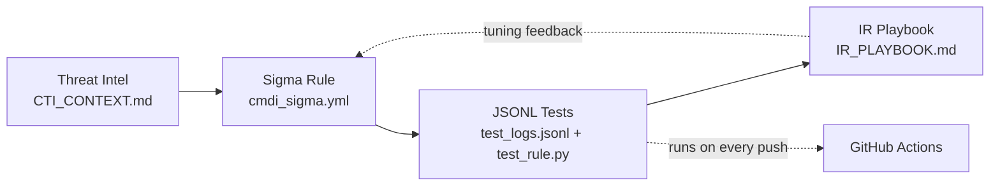

# CWE-078: OS Command Injection

This module provides threat intelligence, a Sigma rule, and an incident response playbook for OS Command Injection (CWE-78) against a diagnostic `/ping` endpoint, with an automated test suite that proves the rule works.

## How the artifacts fit together



Threat intelligence decides what to detect, the Sigma rule encodes it, the tests prove it against labelled logs, and the playbook tells a Tier 1 analyst what to do when the rule fires. Findings from real alerts feed back into the rule.

## Quick start

Run these from the repository root.

```bash
# verified
python -m pip install -r cwe-078-os-command-injection/tests/requirements.txt    # pytest, PyYAML
python -m pytest cwe-078-os-command-injection/tests/                            # all 24 cases plus coverage checks
python -m pytest cwe-078-os-command-injection/tests/ -k TP-07                   # a single case
```

Expected result: `24/24 cases PASS` and `40 passed`.

## What's in this module

| Artifact | File | Purpose |
|---|---|---|
| Threat intel | [CTI_CONTEXT.md](./CTI_CONTEXT.md) | ATT&CK mapping (T1190, T1059), real-world cases, Diamond Model |
| Sigma rule | [detection_rules/cmdi_sigma.yml](./detection_rules/cmdi_sigma.yml) | Detection for Nginx, Apache and IIS web server logs |
| Test coverage | [TESTING.md](./TESTING.md) | Coverage matrix: true positives, evasion, benign traffic, known gap |
| Test corpus | [tests/test_logs.jsonl](./tests/test_logs.jsonl) | 24 labelled raw log lines in three formats |
| Test runner | [tests/test_rule.py](./tests/test_rule.py) | pytest suite evaluating the rule against the corpus |
| IR playbook | [IR_PLAYBOOK.md](./IR_PLAYBOOK.md) | Tier 1 triage decision tree, log sources, escalation criteria |

## Scope

The rule targets a `/ping` endpoint that takes its input in the query string; adjust the two marked lines in the rule header if yours differs. The test logs are synthetic, so they prove the rule logic rather than live false-positive rates, and POST bodies are not visible in web server access logs. Both limits are documented in [TESTING.md](./TESTING.md).
