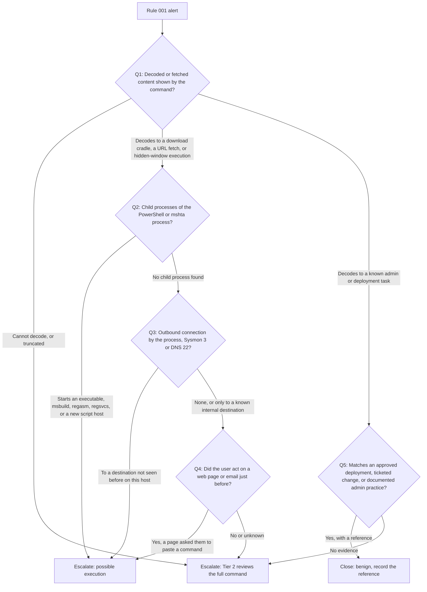

# IR Playbook: Lumma Stealer Delivery Alert (Tier 1)

| | |
|---|---|
| **Playbook ID** | PB-RE-LUMMA-001 |
| **Version / date** | 0.1 draft / 2026-11-22 |
| **Review status** | **Not reviewed.** `ENVIRONMENT_ASSUMPTIONS.md` section 7 assumes a review against the Tier 1 and Tier 2 roles. That has not happened. Do not treat this playbook as approved. |
| **Owner** | [SOC lead / team] |
| **Triggers** | Sigma `re_lumma_001_clickfix_user_powershell.yml` (id `721a50ab-c835-444a-a68f-2f34ffb9169a`), level medium. Sigma `re_lumma_002_browser_store_read_nonbrowser.yml` (id `4b93a263-6439-4ea5-97a3-2d79f9f9f215`), level medium, **only if** your environment enables the 4663 SACL it needs. Sigma `re_lumma_003_c2_useragent_eset.yml` (id `eb261e0a-7f43-404f-9e8b-9a653b2af43e`), level **low**, low confidence, **only if** your proxy logs the User-Agent. |
| **Audience** | Tier 1 analyst. Tier 2 approves containment. |
| **Related** | `CTI_CONTEXT.md`, `ANALYSIS.md`, `iocs.csv`, `ENVIRONMENT_ASSUMPTIONS.md` |
| **ATT&CK (v17 pinned `[ASSUMED]`)** | T1204, T1059.001, T1218.005, T1555.003, T1539. The mapping of each ID to Lumma behaviour is **[A]**. All five IDs have a page in v17 with the same name as in v20.1 **[V: MITRE v17, 2026-11-22]**; see `CTI_CONTEXT.md` section 3.1. |

> **Assumptions.** Roles and telemetry come from `ENVIRONMENT_ASSUMPTIONS.md`: Tier 1 triages and can close or escalate; Tier 2 approves containment, credential resets and host isolation; verdicts go to a channel named `feedback`; Windows 10/11 endpoints; Sysmon 1, 3, 11, 13, 22 and PowerShell 4104 collected; 30 days retention. **No response times are set here**, because the assumptions give none. Add your own SLAs. **No team names, contacts or ticket systems are named.** Every tool step below is generic. Replace it with your products' steps.

## 0. What these alerts do and do not tell you

- **Rule 001 means** `explorer.exe` started PowerShell with an encoded command or a download cradle against a URL, or started `mshta` against a URL. That shape matches the reported ClickFix delivery of Lumma, where the user pastes a command into the Run dialog. **[V: CISA AA25-141B; Microsoft 2025-05-21]**
- **Rule 001 does not mean** the command was malicious, that Lumma ran, or that anything was stolen. Developers and administrators also run such one-liners.
- **Rule 001 does not see** a pasted command that first starts `cmd.exe` (its parent is then not `explorer.exe`), a renamed `powershell.exe`, or a script file. A quiet rule is not proof of no ClickFix.
- **Rule 002 means** a non-browser process opened a browser credential, cookie or key file that carries a SACL. It does not mean theft. It exists only where the audit is enabled; the reference environment does not enable it.
- **Rule 003 means** a POST in the proxy logs carried one of the two User-Agent strings ESET published for Lumma's configuration request. **[V: ESET]** It is **low confidence**: real browsers can send those strings, the proxy does not name the sending process, and no baseline of normal traffic exists. It is a lead, not a finding. A proxy shows no User-Agent for HTTPS that it does not inspect, so it can also be silent while Lumma runs.
- **None of the rules see** C2 traffic content, process hollowing or in-memory loading. Those are documented gaps (`ANALYSIS.md` section 4).

**Ground rules**

1. **Do not run, paste or "test" the command from the alert.** Not in a terminal, not in the Run dialog, not in an online tool.
2. Do not browse to, fetch or resolve any URL or domain in the alert. Do not contact the host's user until Step 1 is done, unless Tier 2 asks you to.
3. Decode Base64 only with a trusted **offline** tool. PowerShell `-EncodedCommand` is Base64 of UTF-16LE text. Never paste it into a website.
4. Defang indicators in tickets and chat (`203[.]0[.]113[.]10`, `hxxps://`).
5. Do not ask the user to "fix" or reboot the machine. Preserve evidence for Tier 2.

## 1. Intake

Record these from the alert, with times in UTC:

| Field | Source |
|---|---|
| Rule id and name | Alert |
| Host, user account, event time | Alert |
| Parent image, child image, full command line | Sysmon 1 fields in the alert |
| Parent and child process ids, process GUIDs | Sysmon 1 |
| For rule 002: accessing process, object name | Security 4663 |
| Whether the command line looks cut short | Compare its length with the visible end. Sysmon can truncate. |

## 2. Triage decision tree

Steps for each question, with the telemetry that the reference environment assumes:

| Q | What to check | Where |
|---|---|---|
| Q1 | Decode the command offline. Note any URL, cradle keyword (`iex`, `downloadstring`, `invoke-webrequest`), `-w hidden`, or second-stage script. If the line is cut short, say so in the ticket. | Sysmon 1 `CommandLine`; PowerShell 4104 script block text for the same host and time **[ASSUMED]** |
| Q2 | List process creations with the alert's process as parent, in the 30 minutes after the alert. Look for a Lumma-reported pattern: PowerShell that launches an executable, or loaders reported to hollow `msbuild.exe`, `regasm.exe`, `regsvcs.exe`, `explorer.exe`. | Sysmon 1 **[V: Microsoft]** for the pattern |
| Q3 | List outbound connections and DNS lookups from the host in the 30 minutes after the alert. Compare destinations against the host's own earlier traffic. Compare against `iocs.csv` only for hashes. Network indicators in that file are synthetic placeholders. | Sysmon 3, 22; proxy or DNS logs with method, URI, User-Agent where available **[ASSUMED]** |
| Q4 | Ask Tier 2 to pull the browser history or email at the time if the facts are unclear. Tier 1 does not browse the history itself. | Needs a response path; no tool is assumed |
| Q5 | Look for a ticket, change record or documented admin task that explains the command. A name alone is not a reference. | Your change system (not assumed) |

**Rule 003 path (low confidence, proxy logs only):**

A hit means a POST carried one of two User-Agent strings (Chrome/119 or Chrome/109 builds) that ESET reports for Lumma's configuration request. **[V: ESET]** Real browsers can send the same strings, the proxy does not name the process, and there is no baseline of normal traffic, so Tier 1 **cannot close or confirm on the proxy record alone**.

1. Note the client address, destination host, time and which of the two strings matched. Do not browse to the destination.
2. Find the host that held that client address at that time, using your asset or address-assignment records. These records are **not defined in `ENVIRONMENT_ASSUMPTIONS.md`**; use what your environment has.
3. On that host, find the process that connected to the destination at that time (Sysmon 3, and Sysmon 22 for the lookup) and its parent chain (Sysmon 1). **[ASSUMED]**
4. If the process is a known browser, check whether the browser is genuinely that old (software inventory or EDR) and whether the destination is a site the user normally visits. A genuine old browser posting to a known site: close as `FP-TUNE` and note it.
5. If the process is **not** a browser, or the destination is new to the host, or rule 001 or rule 002 also fired for the host: **escalate**.
6. If you cannot find the process, close as `INCONCLUSIVE` and name the gap. Do not close as benign.

**Rule 002 path (only where the SACL exists):**

1. Is the accessing process a browser or browser updater that the rule's filter does not list (portable build, other Chromium fork)? Check the file path and signature in EDR. If so, note it as a tuning item and close as a false positive.
2. Is it a known backup, antivirus, sync or password-manager process? Confirm the product and path. If expected, close and note a tuning item.
3. Otherwise treat as possible credential theft and **escalate**. Include the process path, its parent chain from Sysmon 1, and any outbound connection from it in the next 30 minutes (Sysmon 3, 22).

## 3. Escalation criteria (to Tier 2)

Escalate if **any** is true:

- The command decodes to a download cradle, a URL fetch or a hidden-window launch, and Q5 gives no benign reference.
- A new executable or script host started under the PowerShell or `mshta` process.
- The process contacted a destination new to that host.
- The command line is truncated and you cannot decide.
- Rule 002 fired for a process that is not a known tuning case.
- Rule 003 fired and the sending process on the host is not a browser, or the destination is new to the host (section 2, rule 003 path).
- The user reports they pasted a command after a "verification" or "I'm not a robot" page. This matches the reported ClickFix flow. **[V: Microsoft]**

## 4. Hand-off note to Tier 2 (SBAR)

- **Situation:** rule name, host, user, time (UTC), and the one-line reason you escalate.
- **Background:** parent chain, decoded content (defanged), child processes, connections you found, tuning items noted.
- **Assessment:** what you believe happened, what is confirmed (V from telemetry) and what is not.
- **Request:** what you need Tier 2 to decide. For example, approve isolating the host, approve credential resets, pull browser history, or pull a memory or disk package (needs EDR memory capability, which is **not assumed**).

## 5. Tier 2 actions (outline, Tier 2 approves)

Tier 1 does not do these.

| Action | Note |
|---|---|
| Isolate the host | **Requires Tier 2 approval** `[ASSUMED]`. |
| Reset credentials and revoke sessions | **Requires Tier 2 approval** `[ASSUMED]`. If any browser-store access or execution is confirmed, treat every credential saved in the browser on that host and every session cookie as exposed. Reset from a different, clean machine. Revoke active sessions and tokens, not only passwords. Review MFA enrolments for changes. This follows from what the source reports the family collects: browser passwords, cookies, autofill, wallets, VPN configs, email and FTP clients. **[V: Microsoft]** Who performs the reset is not defined in the assumptions. |
| Scope | Search other hosts for the same parent chain, command shape and the hashes in `iocs.csv`. Retention is 30 days, so the look-back stops there. **[ASSUMED]** |
| Wallets | If crypto wallets or wallet extensions are present, tell the user's owner. The family targets them. **[V: Microsoft]** |
| Promotion or tuning | Add a fixture first (section 7), then tune. |

## 6. Closure codes

| Code | Meaning |
|---|---|
| `TP-EXEC` | True positive. Malicious command executed. Escalated. |
| `TP-BLOCKED` | True positive. Command shape matched, execution did not complete (for example blocked by EDR). |
| `BENIGN-ADMIN` | Approved admin or deployment task. Reference recorded. |
| `BENIGN-USER` | Legitimate user action with a clear reason, for example an install one-liner from a vendor page. |
| `FP-TUNE` | False positive that needs a rule change. Tuning item recorded. |
| `INCONCLUSIVE` | Telemetry gap, for example a truncated command line. Say which gap. |

## 7. Feedback fields

Send a verdict to the channel named `feedback` `[ASSUMED]`. Fields:

| Field | Content |
|---|---|
| Closure code | From section 6 |
| Matched indicator or decoded stage | What the rule matched and what the command decoded to (defanged) |
| Evidence of execution | Yes or no, and the process or connection that shows it |
| Detection feedback | One line: what would have made the alert clearer |

Each tuning change adds its fixture first, in `tests/fixtures/`, then the change.

## Appendix A: What each rule's telemetry shows

| Rule | Event | Fields used |
|---|---|---|
| 001 | Sysmon 1 | `ParentImage`, `Image`, `CommandLine` |
| 002 | Security 4663 with SACL | `ObjectType`, `ObjectName`, `ProcessName` |
| 003 | Proxy log | `cs-method`, `c-useragent` (Sigma proxy field names; map to your proxy) |

## Appendix B: Known gaps an analyst should remember

1. No process-memory telemetry is assumed, so injection and in-memory loading are invisible.
2. C2 traffic is HTTPS POST to Cloudflare-fronted hosts. Content is not visible, and Microsoft published no C2 User-Agent. **[V: Microsoft]** ESET lists two for dynamic-config requests. **[V: ESET]** Rule 003 alerts on the two User-Agent strings ESET published, at low confidence (section 2, rule 003 path).
3. Steam and Telegram fallback lookups look like normal web use. **[V: Microsoft; ESET]**
4. The `iocs.csv` hashes are reported by CISA, not verified by us, and the family's builds change over time (ESET reports replaced string-encryption algorithms and network protocol changes). **[V: ESET]** A hash miss means little.

## Appendix C: Version history

| Version | Date | Change |
|---|---|---|
| 0.1 | 2026-11-22 | Draft. Not reviewed. |
