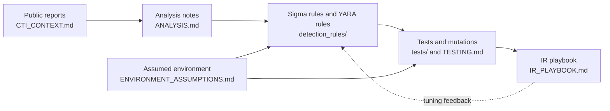

# re-lumma-stealer: Lumma Stealer (LummaC2) detection module

This module is a reverse-engineering style detection package for the Lumma Stealer infostealer, built from public reporting only. It has 3 Sigma rules, 2 YARA rules, a config-structure parser that runs only on synthetic blobs, a Tier 1 IR playbook, and a test suite.

**It is a reference implementation, not a production-proven detection.** No sample was downloaded, run or analysed for it, and the repository handles no samples (`ENVIRONMENT_ASSUMPTIONS.md`, section 3). The tests check rule logic on synthetic data. They do not give a detection rate or a false-positive rate, and the baseline against real endpoints has **not been run**.

## Status

Quoted from [TESTING.md](./TESTING.md): the Sigma rules, YARA rules, config extractor and mutation tests were all run in the official `python:3.12` container, and 175 tests passed. The baseline and real-data measurements have not been run, and no metric targets are set. Read [section 2 of TESTING.md](./TESTING.md#2-what-the-tests-do-and-do-not-show) before relying on any result.

## Confidence of each rule

Taken from each rule's own header. All five rules have `status: experimental`.

| Rule | File | Level | What the header says about confidence |
|---|---|---|---|
| 001 ClickFix-style PowerShell or mshta launched from Explorer | [`re_lumma_001_clickfix_user_powershell.yml`](./detection_rules/sigma/re_lumma_001_clickfix_user_powershell.yml) | medium | Patterns are analyst-derived `[A]`. It fires on the launch, not on proof that Lumma ran. |
| 002 Non-browser process reads a browser credential or cookie store | [`re_lumma_002_browser_store_read_nonbrowser.yml`](./detection_rules/sigma/re_lumma_002_browser_store_read_nonbrowser.yml) | medium | Conditional rule. Its header says it **cannot fire in the reference environment**. The file list, audited access types and browser allow-list are analyst-derived `[A]`. |
| 003 Lumma dynamic-config User-Agent strings (proxy) | [`re_lumma_003_c2_useragent_eset.yml`](./detection_rules/sigma/re_lumma_003_c2_useragent_eset.yml) | low | **Low confidence.** Two strings, `[V: ESET]`; the rule is `[A]`. Legitimate traffic can use those Chrome versions, proxy logs do not record the process name, and there is no baseline. |
| YARA `RE_Lumma_C2_Protocol_Strings` | [`re_lumma_config_strings.yar`](./detection_rules/yara/re_lumma_config_strings.yar) | not applicable | `confidence = "low"`. Analyst-derived from strings in Microsoft's write-up. Real builds may not hold these strings in plain form. |
| YARA `RE_Lumma_ChaCha_WinHttp_Cooccurrence` | [`re_lumma_chacha_setup.yar`](./detection_rules/yara/re_lumma_chacha_setup.yar) | not applicable | `confidence = "low"`. The header calls it likely blind and likely false-positive-prone, and says to use it only as a hunting filter over a corpus, never as an alert. |

## How the artifacts fit together



The assumed environment decides which log sources a rule may rely on. The public reports and analysis notes decide what to detect. The tests show the rule logic works on synthetic data. The playbook tells a Tier 1 analyst what to do when a rule fires.

## Quick start

From the repository root, on Python 3.12:

```bash
# verified
python -m pip install -r re-lumma-stealer/tests/requirements.txt
python -m pytest re-lumma-stealer/tests -q
```

To run it in the official container instead, see the root [README](../README.md#run-the-tests). `yara-python` has no Windows wheel for Python 3.14, so the YARA tests need Python 3.12.

## Artifacts

| File | What it is | Who reads it |
|---|---|---|
| [`ENVIRONMENT_ASSUMPTIONS.md`](./ENVIRONMENT_ASSUMPTIONS.md) | The reference environment the rules were written against. Every value is tagged `[ASSUMED]`. | Anyone deciding which rules apply to them |
| [`CTI_CONTEXT.md`](./CTI_CONTEXT.md) | Threat context from public sources, ATT&CK mapping, and the V, U, A and ASSUMED tag legend | Intel analyst, detection engineer |
| [`ANALYSIS.md`](./ANALYSIS.md) | Desk analysis from public reports: reported static findings, config structure, behaviours as telemetry, rule coverage decisions | Detection engineer, reverse engineer |
| [`detection_rules/sigma/`](./detection_rules/sigma/) | Sigma rules 001 to 003 | Detection engineer |
| [`detection_rules/yara/`](./detection_rules/yara/) | The two YARA rules | Detection engineer, hunter |
| [`IR_PLAYBOOK.md`](./IR_PLAYBOOK.md) | Tier 1 triage tree, escalation criteria, closure codes. Marked unreviewed. | Tier 1 and Tier 2 analysts |
| [`TESTING.md`](./TESTING.md) | Coverage matrices, mutation results, limits, and the real test output | Maintainer, reviewer |
| [`iocs.csv`](./iocs.csv) | SHA-256 hashes from a CISA advisory plus two synthetic placeholder rows. No real hostnames or IP addresses. | Tier 2 analyst |
| [`tools/config_extract.py`](./tools/config_extract.py) | Parser for a **synthetic** ChaCha20 config blob layout. It refuses anything without the test-only magic. | Reverse engineer, maintainer |
| [`tests/`](./tests/) | Fixtures, benign-corpus generators and the pytest suite | Maintainer |
| [`pytest.ini`](./pytest.ini) | pytest settings for this module | Maintainer |

## Deploy a rule

The rules were tested with a small purpose-built evaluator (`tests/sigma_eval.py`) plus pySigma parsing. **No conversion to a real SIEM backend was tested** ([TESTING.md, section 2](./TESTING.md#2-what-the-tests-do-and-do-not-show)). Treat the conversion step as yours to verify.

1. **Check the rule file.** This validates the Sigma syntax. It does not convert anything.

   ```bash
   # verified
   python -m pip install -r re-lumma-stealer/tests/requirements.txt sigma-cli==4.0.1
   sigma check re-lumma-stealer/detection_rules/sigma/
   ```

2. **Convert it for your backend.** Install the `sigma-cli` plugin for your SIEM and choose its pipeline. The plugin names are yours to pick.

   ```bash
   # not verified: needs a backend plugin for your SIEM, and none was installed or tested here
   sigma plugin install <your-backend-plugin>
   sigma convert -t <your-backend> -p <your-pipeline> re-lumma-stealer/detection_rules/sigma/re_lumma_001_clickfix_user_powershell.yml
   ```

3. **Map the field names.** Rules 001 and 002 use Windows and Sysmon field names (`ParentImage`, `Image`, `CommandLine`, `ObjectName`, `ProcessName`). Rule 003 uses the Sigma `proxy` category names (`c-useragent`, `cs-method`) and its header says to map them to your proxy's fields.
4. **Run it alert-only.** Do not let it page anyone or block anything at first. Count the hits for your own environment.
5. **Tune.** There is no baseline of normal traffic in this repository, so alert volume and false-positive rate are unknown until you measure them. Add a fixture for each tuning change before you change the rule, as the playbook says.

## Which rules will work for you

Taken from the rule headers and `ENVIRONMENT_ASSUMPTIONS.md`. Compare it with your own intake answers.

| Rule | Telemetry it needs | It cannot fire without | In the assumed reference environment |
|---|---|---|---|
| 001 | Process-creation events with parent image, image and command line | Sysmon event ID 1, or equivalent process-creation logging | Sysmon 1 is assumed collected. |
| 002 | Security event 4663 (object access) | A SACL on the browser profile paths. Sysmon 11 does not record reads. | The SACL is assumed **not** enabled, so the rule **cannot fire**. |
| 003 | Proxy records with HTTP method and User-Agent | A proxy that can read the HTTP request: plain HTTP, or HTTPS with TLS inspection. Without that it logs a CONNECT with no User-Agent and the rule is blind. | The environment file says the User-Agent is logged "where available". It does not say TLS is inspected, so whether the rule can fire is unknown. |
| YARA (both rules) | A way to scan files or byte strings with YARA | A corpus or scanner to run them on | The reference environment lists no file-scanning telemetry, and its EDR is not assumed to expose process memory. The tests use synthetic byte strings only. |

## What this does not cover

Quoted from [TESTING.md, section 8](./TESTING.md#8-known-limits):

- Rule 001 misses PowerShell started through `cmd.exe`, renamed copies, string-assembled cradles and truncated command lines.
- Rule 002 misses injection into a browser process, path-suffix spoofing, and browsers whose profile is not under `User Data`, such as Opera.
- Process hollowing, in-memory loading and C2 content need telemetry the reference environment does not assume.
- The YARA rules use published strings only. The setup rule may miss the family it names, and it will match benign programs that use ChaCha20 and WinHTTP.
- ATT&CK IDs are not checked against the v17 matrix.

Also: there is no baseline or real-data result, the IR playbook has not been reviewed, and nothing here proves a rule works against a real Lumma build.

## Safety

No sample, payload or real key is committed. The config parser runs only on blobs that the tests generate in memory. Indicators in `iocs.csv` are hashes plus clearly synthetic placeholders. Details are in [`ENVIRONMENT_ASSUMPTIONS.md`](./ENVIRONMENT_ASSUMPTIONS.md) and [`ANALYSIS.md`](./ANALYSIS.md). To report a security problem, see [SECURITY.md](../SECURITY.md).
